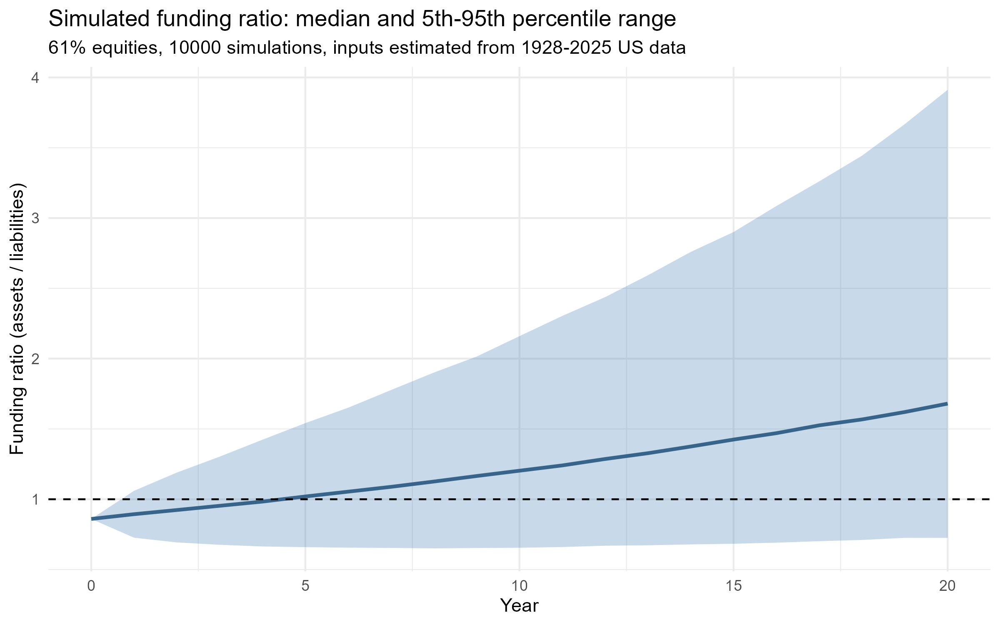
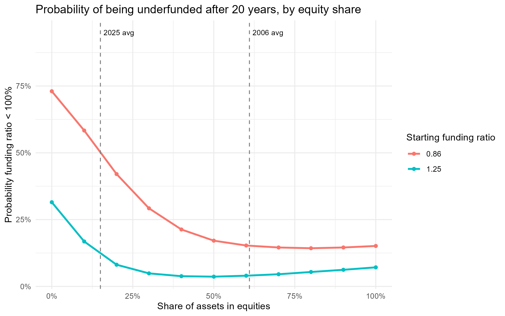

# Pension Scheme Funding Risk: A Monte Carlo Situation

**Question:** How likely is a pension scheme that starts in deficit to become fully funded within 20 years, and how does this depend on it's investment strategy?

## Data 
Annual US returns, 1928-2025, from Aswath Damodaran (NYU Stern):
[Historical Returns on Stocks, Bonds, and Bills](https://pages.stern.nyu.edu/~adamodar/New_Home_Page/datafile/histretSP.html).
- Stocks: S&P 500 including dividends
- Bonds: 10-year US Treasury bonds

My estimated means match the averages published in the source workbook.

## Estimated inputs
| | 1928–2025 (main) | 1976–2025 (sensitivity) |
|---|---|---|
| Stock mean / volatility | 11.9% / 19.4% | 13.2% / 16.0% |
| Bond mean / volatility | 4.8% / 7.9% | 6.6% / 10.1% |
| Stock–bond correlation | 0.02 | 0.05 |

The full sample is the main case. The 1976–2025 window covers four decades of falling
interest rates, which likely overstates future bond returns.

## Scenario choices
| Choice | Value | Reason |
|---|---|---|
| Starting funding ratio | 86% | Average UK DB scheme funding ratio in 2016 (PPF Purple Book), the most recent year the average scheme was in deficit. Sensitivity: 125% (2025 average). |
| Equity share (fan chart) | 61% | Average UK DB equity allocation in 2006 (PPF Purple Book). |
| Horizon | 20 years | Roughly UK life expectancy at 65 (ONS, 2022–2024): the typical length of a pension in payment. |
| Liability growth | Bond mean (4.8%) | An all-bond scheme just keeps pace with its liabilities, so a deficit cannot close without risk. |
| Simulations | 10,000 | Keeps the standard error of estimated probabilities at or below 0.5 percentage points. |

## Method
1. Simulate 10,000 × 20 years of correlated stock and bond returns (multivariate normal).
2. Combine them into portfolio returns for a given equity share.
3. Compound assets and liabilities year by year, and compute the funding ratio.
4. Summarise with the median, 5th and 95th percentiles, and the probability of underfunding.
5. Repeat across equity shares from 0% to 100%, using the same simulated returns.

## Results

With 61% equities and 86% starting funding, the median funding ratio after 20 years is 1.68, the 5th percentile is 0.73, and the probability of being underfunded is 15%.

- Moving from 0% to 50–60% equities cuts the probability of underfunding from 73% to about 15–17%.
- Beyond about 60%, the probability barely changes, while the bad case (5th percentile) worsens.
- For a scheme starting at 125%, the risk of underfunding is lowest at 40–50% equities.

## Checks
- Simulated means, volatilities and correlation match the estimated inputs.
- **Volatility drag:** a naive forecast using average returns predicts a median of 1.92; adjusting for volatility (mean − σ²/2) predicts 1.67; the simulation gives 1.68. Historically, stocks' geometric return (10.0%) is well below their arithmetic mean (11.9%).

## Limitations
- US data applied to a UK-style scheme; US equities performed exceptionally well over this period.
- Returns are assumed normal and independent from year to year; real returns have fatter tails.
- Liabilities grow at a fixed rate, so the model ignores interest-rate risk. Real schemes hold bonds partly to match liability movements (liability-driven investment), so this model undervalues bonds.
- No contributions, benefit payments or changes in strategy over time.

## Use of AI
I used an AI assistant (Claude) throughout this project. I want to be transparent about how, because I see responsible AI use as part of working efficiently as an analyst.

**What I used it for**
- **Learning unfamiliar concepts.** I had no background in pensions, so I used AI to explain ideas such as funding ratios, Monte Carlo simulation, volatility drag, and the role of the Pension Protection Fund.
- **Finding sources.** It pointed me to the Damodaran historical returns data, the PPF Purple Book and ONS life tables. I reviewed each source myself before using it.
- **Thinking through modelling choices.** I used it to understand what to consider when setting the starting funding ratio, time horizon and number of simulations. When early suggestions relied on convention rather than evidence, I asked it for advice on how to pick values that were grounded in data or a calculation. As a result, each value in the model is either estimated from data, linked to a published figure, or derived from a standard-error calculation.
- **Drafting code.** AI produced first drafts of the R scripts. I ran, debugged and organised them, and worked through each step so I understood what the code does.

**How I verified the work**
- Checked my estimated returns against the averages published in the source workbook.
- Built checks into the code: data validation (`stopifnot`), simulated vs estimated inputs, simulated vs theoretical portfolio mean and volatility, and the simulated median vs the volatility-drag prediction.
- Reviewed the results for plausibility and documented the model's limitations.

**What remained my responsibility**
The final modelling decisions, interpretation and conclusions are my own, and I can explain and justify each step. Using AI in this way let me go from no pensions background to a working, documented and verified model in a few days.

## Repository structure
`R/01–05` scripts run in order: download, clean, estimate, simulate, compare strategies.